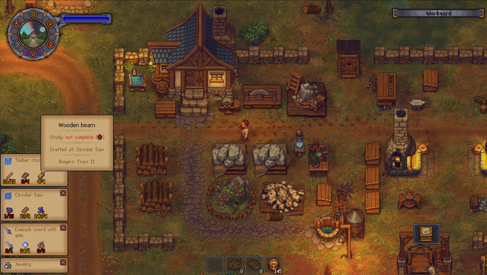

# Multi Recipe Pin

A [BepInEx 5](https://github.com/BepInEx/BepInEx) plugin for **Graveyard Keeper** that pins up to 10 crafting or building recipes to the screen at once.

Each pinned recipe shows its ingredients as `have/need`, counted the same way the workbench does, and hovering an ingredient opens the vanilla item tooltip, including where that item is crafted.

Tested on Graveyard Keeper **1.407** (Steam, Windows) with BepInEx **5.4.x**.



## Features

- Pin recipes from different workbenches and from the build menu at the same time.
- Ingredient counts update live and include the player inventory, bags, toolbelt and all storage in the workbench's zone.
- Yellow count means enough, red means not enough.
- Click a title to collapse an entry, click `×` to unpin it. The oldest entries collapse automatically when the list gets too tall.
- The panel is built from the game's own sprites and fonts and hides in cutscenes, dialogs and other windows.
- Pins are not saved: they reset when you leave to the main menu. Save files are never touched.

## Installation

1. Install **BepInEx 5 (x64)** into the game folder and run the game once.
2. Copy the `MultiRecipePin` folder from the release archive into `<game folder>\BepInEx\plugins\`, so that you get `BepInEx\plugins\MultiRecipePin\MultiRecipePin.dll`.
3. Start the game.

If another recipe pinning mod is installed, disable it: both react to the `P` key.

## Usage

| Action | How |
|---|---|
| Pin / unpin a recipe | Open a workbench or the build menu, hover a recipe, press `P` |
| Unpin from the panel | Left-click `×` on the entry |
| Collapse / expand an entry | Left-click its title |
| See where an ingredient is crafted | Hover the ingredient in the panel |

The panel sits in the bottom-left corner. Pinning past the limit flashes the panel red and adds nothing.

## Configuration

`BepInEx\config\gyk.multirecipepin.cfg` is created on first launch. Changes apply after restarting the game.

| Setting | Default | Description |
|---|---|---|
| `Hotkey` | `P` | Pin / unpin key |
| `MaxPins` | `10` | Maximum pinned recipes (1–10) |
| `WidthPercent` | `14` | Panel width in % of screen width (5–25) |
| `Debug` | `false` | Detailed logging to `BepInEx\LogOutput.log` |

## Limitations

- Works in windows with a recipe list (regular workbenches, the build desk). Alchemy mixing, sermons, embalming and autopsy are not supported.
- Keyboard and mouse only, no gamepad support.

## Building

Requires the .NET SDK and a copy of the game with BepInEx 5 installed. Game assemblies are not part of this repository.

1. Create a `lib` folder in the repository root and copy into it:
   - from `<game folder>\Graveyard Keeper_Data\Managed\`: `Assembly-CSharp.dll`, `Assembly-CSharp-firstpass.dll`, `UnityEngine.dll`, `UnityEngine.CoreModule.dll`, `UnityEngine.InputLegacyModule.dll`, `UnityEngine.Physics2DModule.dll`, `UnityEngine.TextRenderingModule.dll`;
   - from `<game folder>\BepInEx\core\`: `BepInEx.dll`, `0Harmony.dll`.
2. Build, passing your game folder so the DLL is copied into `BepInEx\plugins\MultiRecipePin` afterwards:

```bash
dotnet build -c Release -p:GameDir="C:\Path\To\Graveyard Keeper"
```

The output is `bin\Release\MultiRecipePin.dll`. If `GameDir` does not exist, the copy step is skipped.

## Credits

Behaviour is inspired by the [Recipe Pin](https://www.nexusmods.com/graveyardkeeper/mods/154) mod by PandaModding. This plugin is written from scratch and shares no code with it.